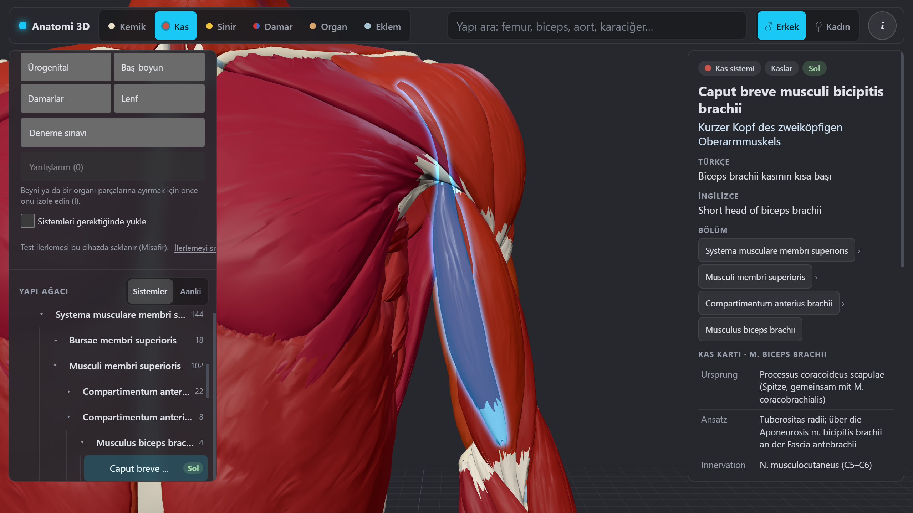
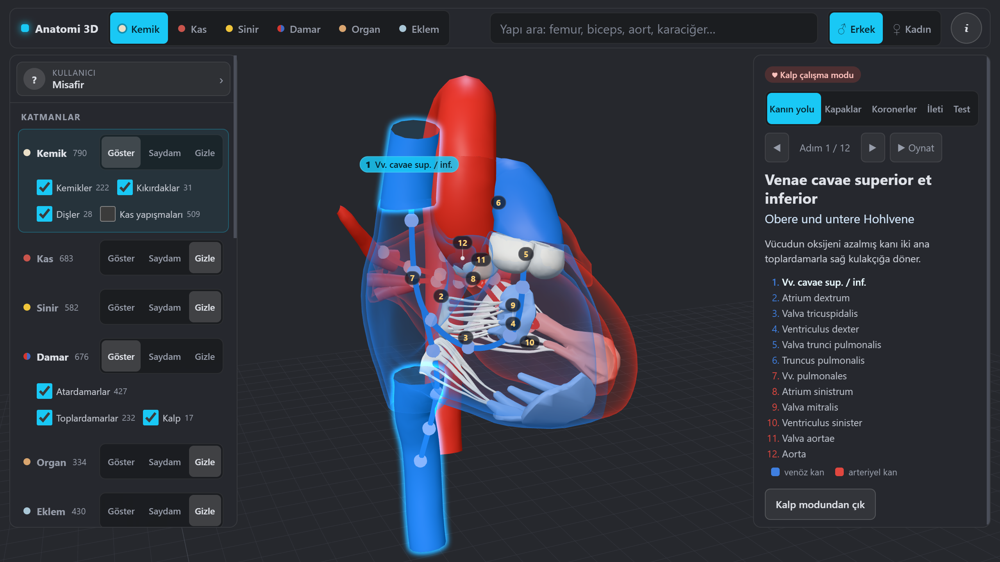
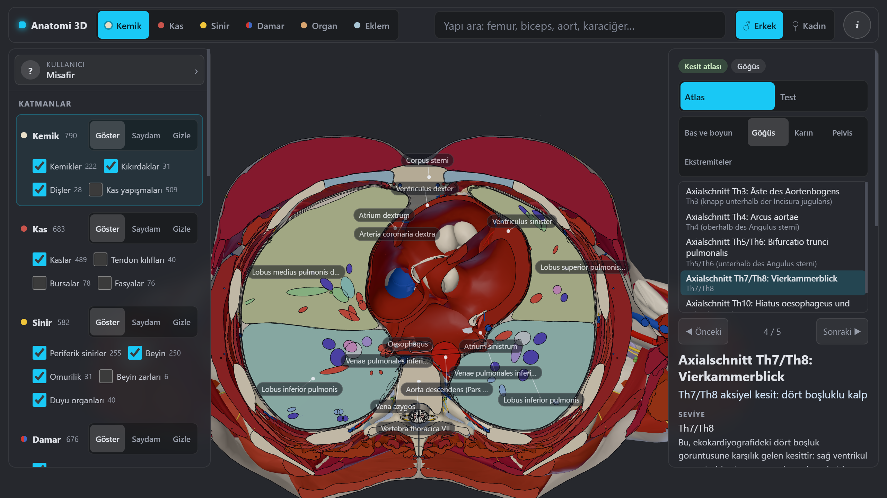
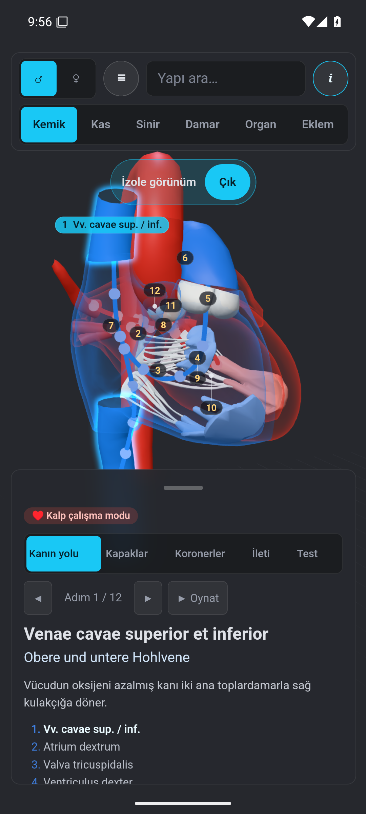

# Anatomi 3D

Anatomi 3D is a free 3D human anatomy atlas that runs in the browser, made for medical students. It has 3495 separate
3D parts in six systems (bones, muscles, nerves, vessels, organs, joints). You can click each part and see its name in
Latin, German, Turkish and English. On top of the atlas there are ten guided study modes, a section atlas laid out like a
CT/MRI atlas, quizzes and a timed mock exam with 1137 questions. It needs no account and no server. It works offline
once installed as a web app, and an Android build exists. The interface is in Turkish; structure names are Latin, with
German below, for students who learn anatomy in German.

**Live site:** https://alikaankaraduman.github.io/anatomi3d-atlas/

The live site is a test deployment. Search engines are asked not to index it.

| | |
|---|---|
|  |  |
| Structure card (Latin name, German below, Turkish and English) with the muscle card | Heart study mode, "Kanın yolu" (path of blood) |
|  |  |
| Section atlas: axial section Th7/Th8 (four-chamber view) | The Android build in the Android 15 emulator (phone layout) |

## What it does

**Atlas.** The male and female bodies are built from the same source model. The male body has 3367 clickable parts and
the female body has 3391; you switch with the ♂/♀ selector. The female pelvis, internal genital organs, breasts, bladder
and some other structures come from separate sources (see [Data sources and licences](#data-sources-and-licences)).

| System | Parts (male / female body) | Contents |
|---|---|---|
| Bones | 732 / 732 | bones, cartilages, teeth, muscle attachment areas (origin red, insertion blue) |
| Muscles | 683 / 683 | muscles, tendon sheaths, bursae, fasciae |
| Nerves | 582 / 582 | peripheral nerves, brain, spinal cord, eye and ear |
| Vessels | 676 / 666 | arteries, veins, heart |
| Organs | 281 / 315 | digestive, respiratory, urinary, genital, endocrine organs, lymph nodes, breasts (female body) |
| Joints | 413 / 413 | ligaments, discs and menisci, joint capsules |

- Select, hide, isolate and focus on structures with the mouse, keyboard or touch. Every system can be shown,
  made transparent or hidden, and its sub-layers can be switched on and off.
- A structure tree in natural anatomical order (vertebrae top to bottom, ribs and cranial nerves by number), and a
  search that accepts Turkish, Latin, German or English names, including the side ("sağ femur" = right femur).
- **Explode** pulls an isolated set apart from its centre. **Section** cuts with a sagittal, coronal or axial plane.
  Cut surfaces are drawn filled in each structure's colour, with outlines, as in a CT/MRI atlas.
- An alternative tree view, **Aanki**, that follows 127 anatomy topics of the Aachen medical students' Anki deck
  (by lecture and day titles; the cards themselves are not in the app). This is an unofficial mapping; the app has no
  connection with Aanki, Fachschaft Medizin Aachen or RWTH Aachen.
- Deep links: the current view is kept in the address (`#s=<part>`, `#t=<topic>`, `#m=<mode>:<tab>`), so a link
  opens the same view.

**Study modes** (each with its own panel, labels and a test tab):

| Mode | Contents |
|---|---|
| Heart | path of blood (12 steps), valves and auscultation points, coronary arteries, a schematic conduction system with an ECG (lead II) on the same time axis |
| Brain | CSF pathway (13 steps, including lumbar puncture), the 12 cranial nerves (exits, skull base foramina, nuclei), arteries and supply areas; 90 knowledge questions |
| Musculoskeletal | 19 peripheral nerves with lesion sites and clinical signs, 24 topographic passages, cards for 246 muscles (origin, insertion, innervation, function), 9 joints |
| Situs, Thorax, Urogenital, Head and neck, Limb vessels, Lymphatic system | six data-driven tours with four content tabs each (125 to 179 items per tour) |
| Section atlas | 29 standard section levels in five regions (head and neck 8, thorax 5, abdomen 5, pelvis 6 counting both bodies, limbs 5); question types: find the structure, name it, which level, knowledge |

**Tests and progress.** Every test saves each answer on the device. A question counts as wrong until you answer it
right twice in a row, and "Yanlışlarım" (my mistakes) repeats only those. The **mock exam** draws from the knowledge
questions of all study modes: 11 topics, 1137 questions, with a choice of topics, number of questions, time limit,
exam or practice mode, a question map, results per topic and a history of the last 20 exams.

**Device-local profiles.** People who share a device can create profiles with a name and password. Each profile
has its own progress and exam history. Profiles exist only on the device where they were created, there is no server,
and the data is not encrypted. The password only keeps the profiles on one device apart.

**Offline and mobile.** The built site is an installable web app (PWA) with a service worker. After the first visit,
the app shell and data are on the device; models are cached when they are used, or all at once (about 33 MB). The
layout adapts to phones (drawer, bottom sheet, touch controls).

The full user guide, in Turkish, is in [docs/kilavuz-tr.md](docs/kilavuz-tr.md).

## How it is built

Vanilla JavaScript with [Three.js](https://threejs.org) r187 and [Vite](https://vite.dev). There is no framework and
no backend, and the build is a static folder. All code is in `app/`.

**Data pipeline** (`app/tools/`). The source models are Z-Anatomy FBX files (based on BodyParts3D) and HuBMAP GLB
files, plus a few other sources. `convert.mjs` runs the Three.js FBX loader in Node (`fbxnode.mjs`); HuBMAP models
are read by `glb.mjs` / `hra.mjs`. Every part is baked to world coordinates, welded, simplified with the meshoptimizer
simplifier, reordered, quantised and written as a meshopt-compressed GLB (`EXT_meshopt_compression`) with
glTF-Transform. Female structures from other sources are fitted to this model by separate registration tools
(`hra-register.mjs`, `hra-breast-fit.mjs`, `fillod-fit.mjs`, `pelvis-warp.mjs`), and their results are committed as
JSON. The female urethra and the Bartholin glands are drawn by code (`urethra.mjs`, `bartholin.mjs`). `meta.mjs` merges
names, groups and the Latin, Turkish and German dictionaries into `public/data/meta.json`. `holes.mjs` computes cap
triangles so that parts with open surfaces can be drawn filled in sections.

**Rendering** (`app/src/model.js`, `stage.js`, `glow.js`). Models are decoded in two workers. Parts in their ordinary
state are drawn through `THREE.BatchedMesh`, two batches per system, so all six systems take about a dozen draw calls instead of
about 2900. Each part also keeps its own mesh for picking and highlighting. Picking uses BVH-accelerated raycasting
([three-mesh-bvh](https://github.com/gkjohnson/three-mesh-bvh)) against the current mode's visible parts; visible
opaque parts of other systems block the ray, so you cannot click a muscle through a bone. Rendering is on demand, and
the selection glow is a separate mask, blur and composite pass.

**Section caps** (`app/src/section.js`). The filled cut surface uses the stencil buffer: back faces on the kept side
increment it, front faces decrement it, and a cap is drawn where it is non-zero. Each cap has the part's colour, an
outline, and is itself clickable.

**Study modes** (`app/src/heart.js`, `brain.js`, `locomotor.js`, `sections.js`, `tour.js`). The six tours run on one
data-driven tour engine (`tour.js`). Each tour is a JSON file (`public/data/<tour>.json`) with tabs, item groups,
colours, texts and questions. The engine works out camera framing, transparent covering shells, labels with leader
lines and the test. A builder (`tools/tour-build.mjs`) checks every structure name against the model and every
question before it writes the file. Points and curves in the heart and brain modes (blood flow, CSF route, nerve exits,
foramina) are computed from the model's own geometry.

**Offline** (`app/public/sw.js`, `app/src/pwa.js`, `app/vite.config.js`). The service worker uses no library. At
build time, the Vite plugin in `vite.config.js` writes the file list into `sw.js`, with a sha256 prefix and the size of
every file. Cache keys and network requests carry the content hash. Unchanged files are copied from the old cache when
a new version comes, so an update downloads only what changed. The body of each download is checked against its hash.
A new version is offered with an "update ready" bar and never activates silently. The same plugin also writes
`lisanslar.txt` (model sources and the licence texts of bundled libraries) and removes internal bookkeeping fields from
the data files. With `ANATOMI_TARGET=pages` it adds a `noindex` robots tag and a strict Content-Security-Policy meta tag
to every HTML page, because GitHub Pages cannot send response headers.

**Profiles** (`app/src/users.js`, `users-ui.js`). Passwords are hashed with PBKDF2-HMAC-SHA256 through Web Crypto
(200 000 iterations, 16-byte random salt, constant-time compare). There is a wait after repeated wrong attempts.
Progress is stored in localStorage under per-profile keys. Profiles can be exported to JSON and imported again, with
strict validation; the export contains no password material. No user or account ships with the app.

**Android** (`app/android/`, `app/capacitor.config.json`). A [Capacitor](https://capacitorjs.com) 8 shell runs the
same build in an Android WebView. In the shell the service worker is turned off, the Android back button is mapped,
and documents open inside the app. The APK is built in GitHub Actions (`.github/workflows/android.yml`). A manual job
boots an Android 15 emulator, installs the APK and runs a smoke test (`app/tools/_qawork/android/`). The test connects
to the WebView over the DevTools protocol, checks that the app starts and that all six systems load, reads back
WebGL pixels, and checks the back button, the in-app documents and a local profile.

**GitHub Pages** (`.github/workflows/pages.yml`). On each push to `main`, the site is built with `ANATOMI_TARGET=pages` and
deployed. The app uses only relative URLs, so it works under the `/anatomi3d-atlas/` sub-path.

## Run, build and test

You need [Node.js](https://nodejs.org) 22 or newer (CI uses Node 24).

```sh
cd app
npm ci
npm run dev        # development server; Vite prints the address (http://localhost:5173 by default)
npm run build      # static build in app/dist (about 33 MB)
npm run preview    # serve app/dist (the service worker only runs in a build, not in the dev server)
```

GitHub Pages variant of the build (adds the robots and Content-Security-Policy meta tags):

```sh
ANATOMI_TARGET=pages npm run build                 # macOS, Linux, Git Bash
$env:ANATOMI_TARGET='pages'; npm run build         # Windows PowerShell
```

Tests:

- `node tools/_qawork/users-test.mjs` (in `app/`): 115 checks for the profile module (password hashing, attempt limit,
  per-profile keys, export and import validation, merge rules, broken or full storage). No browser needed.
- `.github/workflows/android.yml`: run it by hand from the Actions tab to build the debug APK and run the emulator
  smoke test.

The data builders (`tools/tour-build.mjs`, `sections-build.mjs`, `locomotor-build.mjs`, `conduction-build.mjs`,
`meta.mjs`, `npm run convert`) do not work from a clone. They need the source files described in the next section.
Their outputs are committed, so the app runs and builds without them.

## What is not in this repository

- **Raw source models** (the Z-Anatomy FBX files, the HuBMAP, breast and clitoris model downloads). Some files are
  larger than GitHub allows, and all of them are available from their original publishers (links below). The
  repository contains the adapted, compressed models in `app/public/models/`.
- **Content source files and working notes**: the drafts and verified versions of the study texts and questions, the
  geometry reports and review logs that the builders turn into `app/public/data/*.json`. They are working material
  of the build process and include copies of third-party pages used for checking. The built JSON files are in
  the repository.
- Build outputs, installed packages and any signing keys.

## Data sources and licences

The 3D models are adaptations: converted, simplified, renamed and grouped, and in some cases moved or reshaped.
Each one keeps the licence of its source:

- **Z-Anatomy - The libre 3D atlas of anatomy**, Gauthier Kervyn and contributors, CC BY-SA 4.0
  (https://www.z-anatomy.com). It is based on **BodyParts3D**, The Database Center for Life Science, CC BY-SA 2.1 Japan
  (https://dbarchive.biosciencedbc.jp/en/bodyparts3d/download.html). Z-Anatomy includes "Brain for Blender"
  (Brainder, Anderson Winkler, CC BY-SA 3.0, https://brainder.org/brain-for-blender), "White matter" (University
  of Washington; no separate licence given, covered by Z-Anatomy's CC BY-SA 4.0), "Cranial Nerves and Foramina"
  (University of Dundee, CAHID, by Sophia Lappe, CC BY 4.0), "Anatomy of the Inner Ear" (University of Dundee School of
  Medicine, derived from the "3D Ear" model by W. Robert J. Funnell, Sam Daniel and Daren Nicolson at McGill
  University, CC BY-NC-SA 4.0) and "Kidney" (Lissie Cowley, CC BY-NC 4.0).
- **HuBMAP CCF 3D Reference Object Library v1.2**, Kristen Browne, NIAID 3D Printing and Biovisualization; Visible
  Human Female, U.S. National Library of Medicine; CC BY 4.0 (https://humanatlas.io/3d-reference-library): female
  internal genital organs and vagina, female bladder, female pelvis.
- **HuBMAP Human Reference Atlas, 3D Reference Organ: Breast (mammary gland), Female left / right, v1.1**, Heidi
  Schlehlein, CC BY 4.0 (https://doi.org/10.48539/HBM533.BNJL.834, https://doi.org/10.48539/HBM235.CHRK.259).
- **Clitoris model V2 (2016)**, Odile Fillod and Philippe Cosentino, Cité des sciences et de l'industrie (Carrefour
  numérique² FabLab), CC BY-NC-SA (no version given at the source): clitoris and vestibular bulbs.
- **Female urethra and Bartholin glands**: not in any source; drawn schematically for this project from textbook
  descriptions.
- Latin names: Terminologia Anatomica 2 (the Z-Anatomy term table), with abbreviations and spelling errors corrected.
  German names: translated for this project, with Wikidata labels (CC0) as hints. Cortex parcels follow the Destrieux
  atlas (2009).

**Non-commercial parts.** These parts may only be used for non-commercial purposes: the inner ear (cochlea and
vestibule, in `nerves.glb`; CC BY-NC-SA 4.0), the kidney parts (in `organs.glb` and `vessels.glb`; CC BY-NC 4.0) and
the clitoris and vestibular bulbs (`vulva.glb`; CC BY-NC-SA). Any commercial use of the app would require removing them.

Which file comes from which source, what was changed, and the bundled software: [NOTICE.md](NOTICE.md). The built
app ships the same information as `lisanslar.txt` (generated by `app/tools/licenses.mjs`) and shows it in its About (ⓘ)
dialog.

**The repository's own code has no licence yet.** Until the owner chooses one, all rights to the code, the texts and
the questions written for this project are reserved: you may read the code, view and fork the repository on GitHub
(as GitHub's Terms of Service allow) and use the live site, but no licence is granted to reuse, modify or redistribute
them elsewhere. Not covered by this reservation: the adapted models in `app/public/models/` and the data derived from
them or from Z-Anatomy (the Z-Anatomy names and group tree in `app/public/data/meta.json`, `holes.json` and the
points computed from the models' geometry). They keep the licences of their sources listed above (CC BY-SA adaptations
stay under CC BY-SA); see [NOTICE.md](NOTICE.md).

## How this was built

This project was built with an AI coding agent, [Claude Code](https://claude.com/claude-code) by Anthropic.

The repository owner is a medical student. The owner set the goals and priorities, chose the features (for example
Latin names with German below, the Aanki topic view, the study modes, the mock exam, profiles, offline use and the
Android build), made the product, licensing and publishing decisions, and tried the results.

The AI agent wrote the code, the data pipeline and the study material: names and translations, Latin corrections,
the texts of all study modes, the muscle cards, the quiz and exam questions and the Aanki mapping. Separate AI reviewer
agents cross-checked this work, including fact checks of the texts against sources, geometry checks against the
model and code reviews. **No anatomist has reviewed the texts.**

## Limitations

- The texts, names and questions were written and checked by AI, not reviewed by an anatomist, so errors are possible.
  When in doubt, your textbook and your teachers are the reference.
- Everything comes from one male source body, and the female structures are fitted to it. Individual variation is not
  shown. Some structures are missing from the models or are schematic. The female body has no labia or vestibule. The
  female urethra, the Bartholin glands, the heart's conduction system and the subarachnoid CSF route are schematic.
  The heart lacks the pericardium and some valve leaflets. Some nerves and lymph nodes are missing or sit at the wrong
  place (the study modes list these under "not in the model").
- The app has never been tested on a real phone. Phone layouts were tried in touch emulation. The service worker,
  offline start and update flow were tested in headless desktop Edge. Testing was done in Chromium-based browsers only.
- The Android app has only been built in the cloud and tested in an emulator. There is no signed release and no
  store listing.
- There is no iOS build.
- Profiles are local to one device, are not synchronised and are not encrypted.

## Medical disclaimer

Anatomi 3D is for **learning and revision only**. Do not use it for diagnosis, treatment, procedure planning or
patient care. The app collects no personal data. Its settings, progress and profiles stay in the browser storage of
the device.

---

## Türkçe özet

Anatomi 3D, tıp öğrencileri için tarayıcıda çalışan ücretsiz bir 3B anatomi atlasıdır: altı sistemde toplam 3495 yapı
(erkek bedeninde 3367, kadın bedeninde 3391 tıklanabilir; Latince ad, altında Almanca; Türkçe ve İngilizce), on
çalışma modu, kesit atlası, testler ve 1137 soruluk deneme sınavı. Hesap ve sunucu gerektirmez, kurulunca çevrimdışı çalışır. Canlı adres:
https://alikaankaraduman.github.io/anatomi3d-atlas/ · Kullanım kılavuzu: [docs/kilavuz-tr.md](docs/kilavuz-tr.md).
Proje bir yapay zekâ kodlama ajanıyla (Claude Code) yapıldı. Hedefleri, özellikleri ve yayın kararlarını depo sahibi
(bir tıp öğrencisi) belirledi. Kodu, veri hattını ve metinleri yapay zekâ yazdı ve yapay zekâ denetçileri kontrol
etti. Metinleri bir anatomi uzmanı gözden geçirmedi. Uygulama yalnız öğrenme içindir, tıbbi tanı ve tedavide
kullanılamaz. Kodun lisansı henüz seçilmedi (tüm hakları saklıdır); modeller ve onlardan ya da Z-Anatomy'den
türetilen veriler kaynaklarının lisanslarını taşır.
